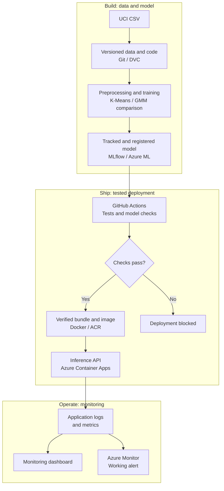
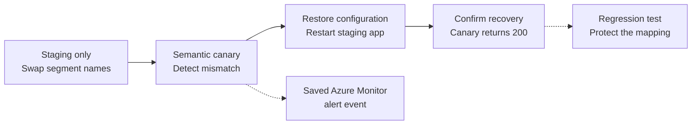

# Travel Style Segmentation & Drift Monitoring

**ITCS355 - Machine Learning Operation and Deployment | Final Project**

An end-to-end MLOps service for grouping travel preferences. It accepts 24 travel-category ratings and returns a K-Means segment, distance from the cluster center, an uncertainty flag, and the model version. The intended user is a travel platform that needs a preference group for personalization. Segment names are provisional; this is not a personality test.

The project covers data versioning, reproducible training, model registration, a FastAPI service, Azure deployment, CI/CD, monitoring, an actual alert, and a deliberate failure with recovery. The comparison model is a Gaussian Mixture Model (GMM).

## Review this submission

1. Read the [submission checklist](#submission-checklist) below to find each required component.
2. Open the [presentation PDF](output/presentation/6688012_6688121_6688193_Presentation.pdf) and the [one-page model card](output/pdf/MODEL_CARD.pdf).
3. Follow the [local review guide](docs/LOCAL_REVIEW.md) to test the API using the companion submission ZIP.
4. Use the [evidence index](docs/FINAL_SUBMISSION.md) for the rubric mapping and saved cloud results.

**Cloud status:** the project resource group has been deleted and cleanup is verified in [reports/cleanup.json](reports/cleanup.json). The deployment workflow is disabled after the demo; [the final status check](reports/submission-status.json) records both states. The Azure API, private DVC remote, registry and live dashboard are therefore no longer available. Their saved evidence remains in this repository. Local review uses the supplied ZIP and does not need Azure.

The repository is public. Its source, Git history and Actions evidence can be reviewed without a collaborator invitation. The companion ZIP includes the source, notebooks, saved reports, public CSV and canonical model so file review does not require GitHub access. Raw data and model binaries are included in the ZIP, not tracked in Git.

## Team

| Student | ID | Proposal responsibilities |
|---|---|---|
| Perawis Buranasing | 6688012 | Data, DVC, preprocessing, training, MLflow and model registry |
| Supitsara Tanasarnsukstid | 6688121 | FastAPI, Docker, Azure deployment, CI/CD and load testing |
| Atichat Kangsamut | 6688193 | Dashboard, drift checks, alerts, failure demo, cost report and model card |

These are the roles in the submitted proposal. All members were assigned to review the final system and demonstration.

## Submission checklist

Checked items identify supplied implementation and saved evidence. They do not claim a rubric score or that the retired cloud services are still running.

- [x] **Versioned data and code:** Git history, [DVC pointer](data/raw.dvc), [data source and SHA-256](reports/data-source.json), [data audit](reports/data-audit.json), and [fresh DVC pull evidence](reports/finish-assets.json).
- [x] **Automated reproducible training:** [stage runner](scripts/reproduce.py), [DVC pipeline](dvc.yaml), [study settings](configs/study.json), and [selection report](reports/selection.json).
- [x] **Registered model with lineage:** [managed training and registry result](reports/finish-training-registry.json), [training proof](reports/azure-training-proof.json), and [bundle manifest](reports/bundle-manifest.json).
- [x] **Deployed inference:** [API source](service/app.py) and [real HTTP deployment checks](reports/ci-deploy-result.json), including golden predictions, invalid input and a batch of 100.
- [x] **CI/CD with tests that can fail:** [workflow](.github/workflows/ci.yml) and [verified successful/blocked deployment evidence](reports/finish-ci-evidence.json).
- [x] **Monitoring dashboard:** [workbook export](reports/dashboard-workbook.json), [chart update evidence](reports/dashboard-chart-update.json), and [saved telemetry](reports/azure-telemetry.json).
- [x] **At least one working alert:** [actual fired/resolved alert record](reports/finish-alert.json). This proves an Azure Monitor alert event; email notifications were not configured.
- [x] **Deliberate failure and recovery:** [staging failure record](reports/finish-failure.json), [confirmed recovery](reports/finish-recovery.json), and [API regression tests](tests/test_api.py).
- [x] **Cost per 1,000 predictions:** [cost report](docs/COST_REPORT.md) and [latest saved billing/count responses](reports/billing-submission-check.json).
- [x] **One-page model card:** [PDF](output/pdf/MODEL_CARD.pdf) and [Markdown version](docs/MODEL_CARD.md).
- [x] **Presentation and demonstration materials:** [15-slide PDF](output/presentation/6688012_6688121_6688193_Presentation.pdf), [PPTX](output/presentation/6688012_6688121_6688193_Presentation.pptx), and [demo notebook](output/presentation/LIVE_DEMO.ipynb).
- [x] **Post-demo cloud cleanup:** [verified resource-group removal](reports/cleanup.json).
- [x] **Local review copy checked:** [validation report](reports/submission-validation.json) records 59 local system/API tests, 12 tests on an extracted ZIP, and matching data/model hashes.

The course brief separates the 30-mark repository assessment from the 15-mark live demo and defense. The final system is assessed against R1-R5; see the [rubric evidence index](docs/FINAL_SUBMISSION.md#rubric-and-evidence-index).

## System



The diagram shows the system used during the completed demo. Cloud resources have since been removed; use the local review copy and saved evidence.

Provider integration is kept in `cloudlayer/`. The bundle contains preprocessing, feature order, clustering model, segment mapping, distance thresholds and version metadata. Startup checks verify the artifact hash, environment and golden predictions before readiness succeeds.

### Deliberate failure and recovery



The deliberate staging failure swaps segment names while the API can still return normal prediction responses. A semantic canary detects the mismatch. The team restored the configuration, confirmed recovery, and retained a regression test for the failure.

## Important paths

All paths below are relative to this repository root.

| Path | Purpose / where to start |
|---|---|
| [docs/](docs/) | Review documents. Start with [FINAL_SUBMISSION.md](docs/FINAL_SUBMISSION.md), [LOCAL_REVIEW.md](docs/LOCAL_REVIEW.md), [COST_REPORT.md](docs/COST_REPORT.md) and [MODEL_CARD.md](docs/MODEL_CARD.md). |
| [reports/](reports/) | Saved JSON/CSV/log evidence. Start with `submission-validation.json`, `finish-ci-evidence.json`, `finish-failure.json`, `billing-submission-check.json` and `cleanup.json`. The evidence index links the exact files. |
| [src/](src/) | Shared data preparation, model study, bundle export and prediction logic: `data.py`, `train.py`, `bundle.py`. |
| [service/](service/) | FastAPI routes in `app.py`; artifact, version and golden checks in `runtime.py`. |
| [tests/](tests/) | Data/model, API contract, semantic regression and provider-operation checks. Local tests mock cloud operations. |
| [scripts/](scripts/) | Local stage runner, WSL setup, HTTP/load checks and portability audit. Full retraining starts with `reproduce.py all` in a separate copy. |
| [notebooks/](notebooks/) | Saved workflow from data audit to delivery. See the [notebook index](notebooks/README.md). Read saved outputs first; cloud notebooks are historical after cleanup. |
| [cloudlayer/](cloudlayer/) | Azure access, Blob transfer, managed training, deployment, CI evidence, monitoring and cleanup operations. These are not needed for local API review. |
| [tracking/](tracking/) | Local MLflow experiment records and model registration helpers. |
| [monitoring/](monitoring/) | Controlled input-drift check and monitoring queries. The drift experiment is offline. |
| [infra/](infra/) | Azure platform and recovery templates. Applying them creates resources; review does not require deployment. |
| [configs/](configs/) | Data split, study, cloud and cost settings. |
| [data/raw.dvc](data/raw.dvc) | Version pointer for the raw CSV. The actual `data/raw/google_review_ratings.csv` is included in the companion ZIP. |
| `models/artifacts/abfd88e893ca/bundle.joblib` | Canonical tested model, included in the ZIP. Its expected hash is in [the manifest](reports/bundle-manifest.json). |
| [output/presentation/](output/presentation/) | Presentation PDF/PPTX, demo notebook, helper and report-based figures. |
| [output/pdf/](output/pdf/) | One-page model card and an earlier exported presentation PDF. Use the ID-named presentation above as the final deck. |
| [proposals/current/](proposals/current/) | Original submitted proposal. Its latency and budget numbers are targets, not measured results. |
| [requirements-service.lock.txt](requirements-service.lock.txt) | Pinned local API/runtime dependencies; add `httpx==0.28.1` for API tests. Other requirement files support training, notebooks, tracking and cloud work. |

## Run a local review

Extract the companion ZIP and open its `MLOP-PJ` directory in WSL/Linux. Use **Python 3.13.11**. A new review environment can run:

```bash
python3 --version
python3 -m venv .venv-review
source .venv-review/bin/activate
python -m pip install -r requirements-service.lock.txt httpx==0.28.1
python scripts/portability_audit.py
python -m unittest tests.test_contract_ci tests.test_api tests.test_runtime
python -m uvicorn service.app:app --host 127.0.0.1 --port 8000
```

Check the Python version before continuing. Open <http://127.0.0.1:8000/docs> after starting the server. Stop it with Ctrl+C. The [local review guide](docs/LOCAL_REVIEW.md) includes hash checks, request examples and the separate training procedure.

| API route | Purpose |
|---|---|
| `GET /health` | Process liveness |
| `GET /ready` | Confirms a checked model is loaded |
| `POST /predict` | Scores 1-100 profiles, each with exactly 24 named finite numeric ratings in [0,5] |
| `GET /canary` | Checks semantic mapping against golden profiles |

Use the `profiles` array in [reports/golden-profiles.json](reports/golden-profiles.json) as example input. Invalid requests return 422. Valid uncertain profiles return 200 with a null segment. Distance is not a probability.

For a Git-only checkout, raw data and the binary model are absent. Obtain the exact files from the attached ZIP or follow the public UCI download and separate reproduction steps in [LOCAL_REVIEW.md](docs/LOCAL_REVIEW.md#repository-only-checkout). The retired private DVC remote cannot be pulled after cleanup.

## Results and limitations

| Measure | Saved result / interpretation |
|---|---|
| Data | 5,456 raw rows; 5,454 accepted; two quarantined. Identical profiles remain in one split: 3,817 train, 817 validation, 820 test. IDs are excluded from features. |
| Clustering | K-Means k=5: validation silhouette 0.1448, test silhouette 0.1445. GMM validation silhouette 0.0957. These are clustering metrics, not prediction accuracy. |
| Warm latency | Local p95 274.54 ms; initial cloud p95 813.77 ms. A separate pooled-client check measured 624.83 ms over 200 requests at concurrency 10. Client methods differ; cloud results include network time and miss the team's 300 ms target. |
| Cold activation | One readiness request after verified zero replicas: 3,819.60 ms, including network and activation. This is not a cold-start percentile. |
| Drift | Offline controlled input shift. Input drift alone does not prove concept drift or quality loss. |
| Cost | Planning estimate: 88.89 THB, or 8.89 THB per 1,000 assumed predictions. Latest saved reported cost: 1.44540968 USD / 2,707 profiles * 1,000 = 0.53395260 USD per 1,000 profiles. Billing is provisional and includes idle cloud time. |
| Validation scope | Existing pinned WSL environment used; no fresh package installation or full study rerun was performed during final review. |

Measurement files: [local latency](reports/serving-recheck/local-load.json), [initial cloud latency](reports/azure-load.json), [pooled cloud check](reports/pooled-load.json), [cold activation](reports/finish-cold.json), [drift](reports/input-drift.json), and [cost report](docs/COST_REPORT.md).

## CI and delivery evidence

The verified CI source is `9fea51ae4e81251ac358a2c62139df591688275d`:

- [Successful tests and deployment](https://github.com/DewPerawis/ITCS355-Final-PJ-6688012-6688121-6688193/actions/runs/38173375457)
- [Intentional failed test; deployment skipped](https://github.com/DewPerawis/ITCS355-Final-PJ-6688012-6688121-6688193/actions/runs/38173380800)

The second run is expected evidence of the deployment gate. It is separate from the staging semantic-failure demo. Later documentation/report changes retain this evidence only while the CI inputs match the tested source. No post-cleanup cloud deployment is needed for documentation updates.

See [delivery status](docs/DELIVERY_STATUS.md) for current saved checks and [dataset attribution](docs/DATA_LICENSE.md) for the UCI source and license. The ZIP includes `SUBMISSION_MANIFEST.json` with its base commit, tested CI commit and per-file SHA-256 values. It is a file-review snapshot; Git history and Actions remain in this repository.
